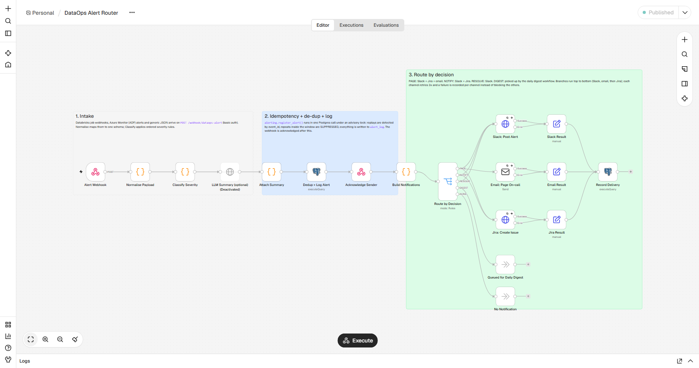
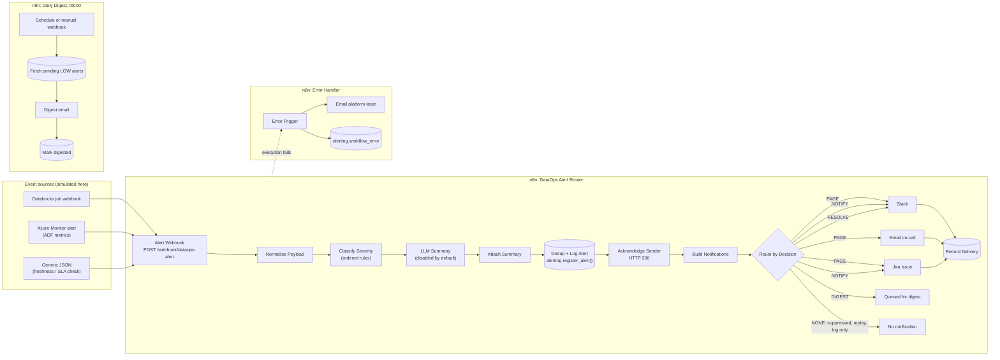
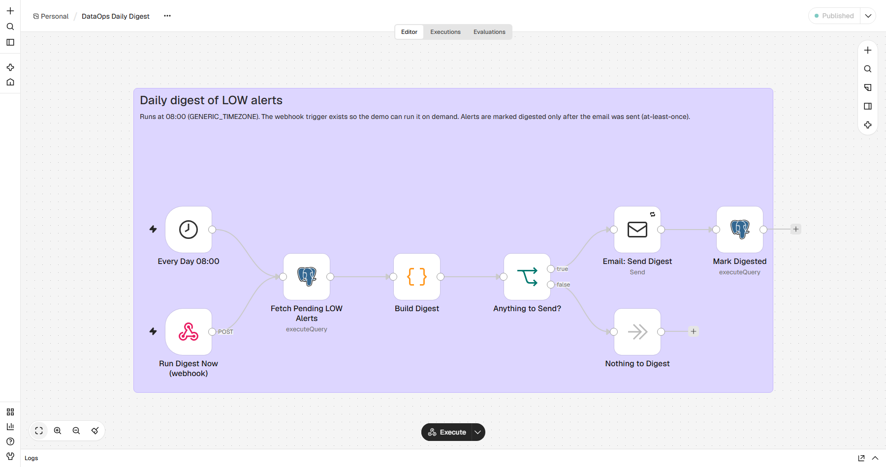

# n8n DataOps Alerts

Event-driven alert routing for data pipelines, built with n8n. Failure and SLA-breach events shaped
like Databricks job webhooks and Azure Monitor alerts for Azure Data Factory go into one n8n webhook.
The workflow normalises them, classifies severity with explicit rules, drops duplicates within a time
window, logs every alert to Postgres, and routes it:

| Severity | Route | Goes to |
|---|---|---|
| CRITICAL | `PAGE` | Slack + Jira ticket + email to on-call |
| HIGH | `NOTIFY` | Slack + Jira ticket |
| LOW | `DIGEST` | one daily digest email |
| recovery | `RESOLVE` | Slack "resolved" message, if something was open |

> **Portfolio project, built with AI-assisted development (Claude Code).** The events are simulated (`simulator/`), and Slack and Jira are replaced
> by a local mock service. It has not been used in production or for any employer or client. Everything
> below was run locally; the captured output is in [docs/demo.md](docs/demo.md).

The whole demo runs with `docker compose` and needs no Slack, Jira or SMTP account: a FastAPI mock
stands in for Slack and Jira, and [Mailpit](https://mailpit.axllent.org/) catches the email.



## Contents

- [Architecture](#architecture)
- [How it works](#how-it-works)
- [Run it locally](#run-it-locally)
- [Connect real Slack, Jira and email](#connect-real-slack-jira-and-email)
- [Design decisions](#design-decisions)
- [What I'd do in production](#what-id-do-in-production)
- [Tests and CI](#tests-and-ci)
- [Repository layout](#repository-layout)
- [What is and is not verified](#what-is-and-is-not-verified)

## Architecture



Locally, "Slack" and "Jira" are the `mock-receiver` container, email goes to Mailpit, and Postgres
holds both n8n's own database (`n8n`) and the alert log (`dataops_alerts`, schema `alerting`).

| Service | Image | Local URL |
|---|---|---|
| n8n | `n8nio/n8n:2.45.7` | http://localhost:5678 |
| Postgres | `postgres:17.11-alpine` | `127.0.0.1:5433` |
| Mailpit | `axllent/mailpit:v1.32.0` | http://localhost:8025 |
| mock-receiver | built from `mock_receiver/` | http://localhost:8000/requests |
| n8n-import | `n8nio/n8n:2.45.7` (one-shot) | imports and publishes the workflows, then exits |

## How it works

### The three inbound shapes

| Shape | Recognised by | Example |
|---|---|---|
| Databricks job notification webhook | `event_type` starts with `jobs.` | `{"event_type": "jobs.on_failure", "workspace_id": "...", "run": {"run_id": 1}, "job": {"job_id": "101", "name": "nightly_sales_etl"}}` |
| Azure Monitor common alert schema | `schemaId == "azureMonitorCommonAlertSchema"` | ADF metric alert on `PipelineFailedRuns` or `PipelineElapsedTimeRuns`, `monitorCondition` `Fired` or `Resolved` |
| Generic JSON | has `source` and `pipeline` | `{"source": "sla_monitor", "event_type": "sla_breach", "pipeline": "gold.sales_daily", ...}` |

Anything else that is a JSON object is kept as source `unknown` and ends up in the digest, so an
unexpected sender is never silently dropped. JSON Schemas for the three shapes are in
[`simulator/schemas.py`](simulator/schemas.py).

### Router workflow, node by node

1. **Alert Webhook**: `POST /webhook/dataops-alert`, HTTP basic auth (n8n credential
   *Alert webhook (basic auth)*). Response mode is "Respond to Webhook node", so the sender gets an
   answer only after the alert has been stored.
2. **Normalise Payload** (Code, [`normalise.js`](workflows/src/normalise.js)): maps each shape to one
   record: `source`, `event_type` (`failure` / `sla_breach` / `info`), `status` (`FIRING` /
   `RESOLVED`), `pipeline`, `environment`, `run_id`, `run_url`, `error_message`, and two keys:
   - `event_id` identifies one delivery of one source event (Databricks: workspace + job + run + event
     type; Azure: `alertId` + status; generic: the sender's `event_id`). It is the idempotency key.
   - `fingerprint` is `source:environment:pipeline:event_type` and identifies "the same problem". It is
     the de-duplication key. A Databricks `jobs.on_success` and an Azure `Resolved` produce the same
     fingerprint as the failure they resolve.

   Environment comes from a workspace-id lookup (Databricks) or the factory name, e.g.
   `adf-dataops-prod` (Azure). A body that is not a JSON object throws, which fails the execution
   and fires the error workflow.
3. **Classify Severity** (Code, [`classify.js`](workflows/src/classify.js)): ordered rules, first match
   wins, with a small pipeline tier catalog (tier 1 = revenue or regulatory impact):

   | Rule | Condition | Severity | Route |
   |---|---|---|---|
   | R1_recovery | status is `RESOLVED` | INFO | RESOLVE |
   | R2_non_prod | environment is dev, test, qa, uat, staging or sandbox | LOW | DIGEST |
   | R3_tier1_failure | failure of a tier-1 pipeline | CRITICAL | PAGE |
   | R4_upstream_sev0_sev1 | Azure Monitor rule severity Sev0/Sev1 (not info events) | CRITICAL | PAGE |
   | R5_prod_failure | any other failure | HIGH | NOTIFY |
   | R6_sla_breach_tier1_2 | SLA breach on a tier-1 or tier-2 pipeline | HIGH | NOTIFY |
   | R7_default_low | everything else | LOW | DIGEST |

   The rule id and reason travel with the alert into Slack, Jira, email and the log, so every routing
   decision can be explained. An unknown environment is treated like production on purpose.
4. **LLM Summary (optional)**: an HTTP Request to an OpenAI-compatible `/chat/completions` endpoint
   (`LLM_API_BASE`, `LLM_MODEL`, key in the *LLM API key* credential). **Disabled by default**; n8n
   passes data through disabled nodes. It is set to continue on error.
5. **Attach Summary** (Code): uses the LLM text if there is one, otherwise keeps the rule-based
   summary. The LLM is never on the critical path of an alert.
6. **Dedup + Log Alert** (Postgres): one call to `alerting.register_alert($1::jsonb, $2::int)`
   ([`db/schema/alerting.sql`](db/schema/alerting.sql)) with bind parameters. In one transaction,
   under a per-fingerprint advisory lock, it:
   - returns the existing row with `is_replay = true` if this `event_id` was seen before;
   - for `RESOLVED`: `RESOLVE` if a HIGH/CRITICAL window was open (and closes it), else `LOG_ONLY`;
   - `SUPPRESS` if the fingerprint already has a window younger than `DEDUP_WINDOW_MINUTES` and this
     is not an escalation (a higher severity breaks through);
   - otherwise the route from the rules (`PAGE` / `NOTIFY` / `DIGEST`), opening a new window;
   - inserts the alert, including suppressed ones, into `alerting.alert_log` with its occurrence number.
7. **Acknowledge Sender** (Respond to Webhook): `200 {"alert_id", "decision", "replay", "occurrence",
   "severity", "rule", "fingerprint"}`. The workflow continues after the response.
8. **Build Notifications** (Code, [`build_notifications.js`](workflows/src/build_notifications.js)):
   Slack Block Kit message, Jira issue fields, HTML and text email, and the `action` to switch on.
   `action` is `NONE` for suppressed, replayed and log-only alerts.
9. **Route by Decision** (Switch): outputs `PAGE`, `NOTIFY`, `RESOLVE`, `DIGEST`, and a fallback `NONE`.
10. **Slack: Post Alert**, **Email: Page On-call**, **Jira: Create Issue**: each retries 3 times with
    2 s between attempts, then sends the failure to its error output instead of stopping the
    execution. URLs, addresses and the Jira project key and issue type come from env vars; the
    Jira user/token and SMTP login are n8n credentials.
11. **Slack / Email / Jira Result** (Set) and **Record Delivery** (Postgres): one row per channel in
    `alerting.delivery_log` with `SENT` or `FAILED`, the Jira key or SMTP message id, and the error.
12. **Queued for Daily Digest** and **No Notification** (No-op): end points that make the outcome
    visible in the execution view.

### Daily digest workflow

Runs at 08:00 in `GENERIC_TIMEZONE` (Asia/Kolkata by default). A second trigger,
`POST /webhook/dataops-digest`, runs it on demand. It selects LOW alerts not yet digested, groups
them per fingerprint with counts ([`build_digest.js`](workflows/src/build_digest.js)), sends one email,
and only then marks them `digested_at` (at-least-once: a failed send leaves them pending for the next run).



### Error workflow

Both workflows name *DataOps Alert Router - Error Handler* as their error workflow. When an
execution fails (bad payload, database down, a bug), it emails `PLATFORM_EMAIL_TO` and writes a row to
`alerting.workflow_error`. Each branch is set to continue on error, so that a database problem
does not also stop the email.

### Alert-log tables

| Object | Purpose |
|---|---|
| `alerting.alert_log` | every alert received, with decision, occurrence, rule, summary and full payload |
| `alerting.dedup_state` | one row per fingerprint with an open window |
| `alerting.delivery_log` | one row per channel attempt that finished (`SENT` / `FAILED`) |
| `alerting.workflow_error` | failures caught by the error workflow |
| `alerting.alert_overview` | view: alerts joined with their deliveries |

## Run it locally

Needs Docker with Compose v2 and Python 3.11+. The simulator uses only the standard library.

```bash
cp .env.example .env
# edit .env: replace every "change-me" value (any random strings work locally),
# e.g. N8N_ENCRYPTION_KEY from `openssl rand -hex 32`

docker compose up -d --build
docker compose logs n8n-import        # credentials + 3 workflows imported and published
```

The first start takes a few minutes while images are pulled and n8n runs its migrations. Nobody has
to log in to n8n: the `n8n-import` container imports credentials and workflows with the n8n CLI
(`n8n import:credentials`, `n8n import:workflow`, `n8n publish:workflow`) before n8n starts, and
production webhooks work without an owner account.

Fire the scenarios (the simulator waits until n8n has registered the webhooks):

```bash
python -m simulator.simulate --reset --run-digest   # --reset clears earlier demo data
python -m simulator.simulate --list                 # scenarios
python -m simulator.simulate -s duplicate_burst     # just one
```

| Scenario | What is sent | Expected |
|---|---|---|
| `databricks_failure` | `jobs.on_failure` for tier-1 `nightly_sales_etl` | PAGE |
| `adf_failure` | ADF `PipelineFailedRuns` fired, then the identical delivery again | NOTIFY, then replay |
| `sla_breach` | Databricks duration warning (tier 1), freshness check (tier 1), ADF elapsed-time (tier 3) | NOTIFY, NOTIFY, DIGEST |
| `non_prod_failure` | failure in the dev workspace | DIGEST |
| `duplicate_burst` | 5 failures of one job, sent concurrently | 1 NOTIFY + 4 SUPPRESS |
| `recovery` | ADF failure, its `Resolved`, a dev job success | PAGE, RESOLVE, LOG_ONLY |
| `jira_outage` | mock Jira set to return 503 three times, then a Sev1 ADF alert | PAGE; Jira `FAILED`, Slack and email `SENT` |
| `unknown_payload` | JSON from an unknown tool | DIGEST |
| `malformed_payload` | a JSON array | HTTP 500, error workflow fires |

Then look at the results:

- What "Slack" and "Jira" received: http://localhost:8000/requests (or `docker compose logs mock-receiver`)
- Emails (on-call, digest, platform error): http://localhost:8025
- The alert log:

  ```bash
  docker compose exec postgres psql -U dataops -d dataops_alerts \
    -c "SELECT * FROM alerting.alert_overview ORDER BY alert_id"
  ```

- Everything at once, as Markdown: `python scripts/demo_report.py`
- The n8n editor and execution history: http://localhost:5678. On the first visit n8n asks you to
  create the owner account of this local instance (it is stored in the local Postgres only). To skip
  that screen, set the `N8N_INSTANCE_OWNER_*` variables in `.env` before starting (see the comments in
  `.env.example`); that is how the screenshots here were taken (`scripts/screenshot_canvas.py`).

On Windows, scripts use `127.0.0.1` rather than `localhost`: the ports are bound to IPv4 only, and
Python spent about 2 s per request trying `::1` first.

Stop with `docker compose down` (keeps data) or `docker compose down -v` (deletes the volumes).

## Connect real Slack, Jira and email

Edit `.env`, then `docker compose up -d`. Compose recreates the containers whose settings changed,
and the import step re-renders the n8n credentials from the new values.

- **Slack**: create a Slack app with *Incoming Webhooks*, add a webhook to your alert channel, and set
  `SLACK_WEBHOOK_URL`. The URL itself is the secret, so keep it out of version control.
- **Jira Cloud**: set `JIRA_BASE_URL=https://<your-site>.atlassian.net`, `JIRA_USER_EMAIL`,
  `JIRA_API_TOKEN` (an Atlassian API token), `JIRA_PROJECT_KEY` and `JIRA_ISSUE_TYPE` (must exist in
  that project). The request uses REST v2 `POST /rest/api/2/issue` with a plain-text description and
  priority `Highest`/`High`; if your priority scheme uses other names, change `jiraFields()` in
  `workflows/src/build_notifications.js` and run `python scripts/build_workflows.py`.
- **Email**: set `SMTP_HOST`, `SMTP_PORT`, `SMTP_SECURE`, `SMTP_USER`, `SMTP_PASSWORD` and the
  addresses (`ONCALL_EMAIL_TO`, `DIGEST_EMAIL_TO`, `PLATFORM_EMAIL_TO`, `ALERT_EMAIL_FROM`).
- **Real senders**: n8n has to be reachable over HTTPS from the cloud (set `N8N_WEBHOOK_URL` to the
  public URL). In Databricks, create a notification destination of type *Webhook* pointing at
  `/webhook/dataops-alert` with the basic-auth user and password, and attach it to the job's failure,
  duration-warning and success notifications. For Azure Monitor, use an action group with a webhook
  action and the common alert schema; check which authentication that webhook action can send (for
  example the secure-webhook option with Microsoft Entra ID) and put an authenticating proxy in front
  of n8n if it cannot do basic auth. That part is not built here.

## Design decisions

**Two keys: `event_id` for idempotency, `fingerprint` for de-duplication.** They answer different
questions. "Did I already process this delivery?" protects against webhook retries: the same Azure
alert sent twice must not page twice. "Is this the same problem as ten seconds ago?" protects people
from noise: five runs of a job failing in a row are one incident. Replays change nothing (no new row,
no counter change); duplicates are logged with an occurrence number but not sent.

**The de-dup window is fixed from the first notification, not sliding.** With a sliding window, a job
that fails every 10 minutes under a 15-minute window would never notify again. With a fixed window,
the most you get is one notification per fingerprint per window, which doubles as a reminder that
something is still broken. Two exceptions break through: an escalation (a higher severity for the same
fingerprint) and anything after a recovery, because a recovery closes the window. The window length
is `DEDUP_WINDOW_MINUTES` (15 by default).

**The check-and-insert is one Postgres call.** Doing "look for a recent alert" and "insert alert" as two
n8n nodes would race: concurrent webhook executions would all see nothing and all notify. The
`register_alert()` function takes a transaction-scoped advisory lock per fingerprint and relies on a
unique `event_id`. The `duplicate_burst` scenario sends five events at once through n8n (1 NOTIFY,
4 SUPPRESS in the demo run), and `tests/test_dedup_sql.py` does the same with 20 threads directly
against Postgres.

**Acknowledge after logging, before fan-out.** The sender gets `200` once the alert is safely in
Postgres. If anything before that fails, n8n answers `500` and the sender can retry; the
malformed-payload scenario shows this path (a Postgres outage would take the same path, but I did not
test that). A Slack or Jira outage does not make the sender retry, which would only create
duplicates; it is handled per channel instead.

**A failing channel does not block the others.** Each channel retries, then goes to its error output,
and the outcome is written to `delivery_log`. Branches run top to bottom (n8n's v1 execution order
follows canvas position), so the human-facing channels (Slack, then email) go before Jira. In the
demo, the on-call email for the Jira-outage alert went out before the first Jira attempt.

**Error workflow for failures of the alerting itself.** Anything that fails the execution (an
unparseable body, a database error, a bug in a Code node) triggers the error workflow, which emails a
different audience over a different channel and logs to Postgres. Each branch continues on error,
so a database failure should not stop the email (that case was not tested).

**Why n8n rather than a custom service.** The flow is readable on one canvas by people who did not
write it; retries, credential encryption, scheduling, error workflows and a searchable execution
history (open the exact run for an alert) come built in; and swapping the Slack webhook for the Slack
node, or adding Teams or PagerDuty, is configuration rather than code. The parts that must be correct
are still code: the Code-node JavaScript is unit-tested by executing it with Node, and the
concurrency-sensitive part is a SQL function with its own tests. The costs: exported workflow JSON
is awkward to review (here it is generated from source files, see below), a single n8n instance is not
built for high throughput (see production), and n8n's Sustainable Use License is not an OSI
open-source licence, so its terms need checking for your use.

**Workflow JSON is generated, not hand-edited.** `scripts/build_workflows.py` assembles the three
workflows from `workflows/src/*.js` with deterministic node and workflow ids, so diffs are readable,
re-imports overwrite instead of duplicating, and CI fails if the committed JSON is stale. The output is
the normal n8n export format; the import container loads it with `n8n import:workflow`.

**Secrets in credentials, settings in env vars.** Passwords and tokens are rendered into n8n
credentials at startup (encrypted with `N8N_ENCRYPTION_KEY`) and referenced by id; nothing secret is
in the workflow JSON, which a test checks. Non-secret settings such as URLs and addresses are read
with `$env`, which needs `N8N_BLOCK_ENV_ACCESS_IN_NODE=false`. That is a real trade-off: with env access
unblocked, any workflow on the instance can read every environment variable of the n8n process,
including its database password and encryption key. It is acceptable for a single-user local demo and
is the first thing I would change for production.

**Unknown input is kept, not dropped.** An unrecognised payload becomes a LOW alert with the raw body
attached, and an unknown environment is treated like production. Missing an alert is worse than an
extra line in the digest.

## What I'd do in production

- Run n8n in queue mode (Redis plus workers, separate webhook processes) and use external task runners;
  the 2.45 logs already flag internal runner mode as deprecated.
- Keep `$env` access blocked and move settings to credentials, a config table or an external secret
  store.
- Put the webhook behind HTTPS with authentication that fits each sender (basic auth for Databricks,
  an authenticating proxy or gateway for Azure Monitor) and restrict source IPs where possible.
- Enrich Databricks events from the Jobs API (`runs/get`) to get the failing task and error text;
  the webhook payload does not contain them.
- Move the tier catalog and rules into a table or a reviewed config file owned by the data team.
- Make Jira idempotent across windows: search for an open issue with the fingerprint label, comment
  on it instead of creating a new one, and transition it on recovery. Post Slack repeats and
  recoveries into the original thread with the Slack Web API.
- Use a paging tool (PagerDuty, Opsgenie) for CRITICAL instead of email.
- Give n8n a least-privilege database role, keep the alert log apart from n8n's own database,
  partition or purge `alert_log` by month, and set n8n's execution-data pruning.
- Alert on the alerting: a scheduled synthetic event that must arrive end to end, and a check on
  `delivery_log` failures.
- Run the docker-compose stack and the simulator in CI as an integration test, not only locally.

## Tests and CI

```bash
pip install -r requirements-dev.txt
pytest                                   # Node.js on PATH runs the Code-node tests
TEST_DATABASE_URL=postgresql://dataops:<password>@127.0.0.1:5433/postgres pytest   # + SQL tests
python scripts/build_workflows.py --check
```

| File | What it checks |
|---|---|
| `tests/test_payload_schemas.py` | every simulator payload validates against the JSON Schema of its shape |
| `tests/test_code_nodes.py` | the JavaScript stored in the workflow JSON, run with Node: normalisation of each shape, every severity rule, that each scenario's expected route follows from the rules, summary handling, notification payloads (including HTML escaping), digest building |
| `tests/test_workflow_structure.py` | import format, unique names, every connection valid, every node reachable from a trigger, webhook paths and auth, the routing matrix, retries and error outputs per channel, LLM node disabled, error workflow wired, no expressions inside SQL, no hardcoded secrets, credential references provisioned by the import script, JSON in sync with `workflows/src` |
| `tests/test_dedup_sql.py` | `register_alert()` against real Postgres: suppress, replay, escalation, window expiry, recovery, and concurrent bursts (needs `TEST_DATABASE_URL`) |
| `tests/test_mock_receiver.py` | the mock Slack/Jira endpoints |

Local result for the final demo run: `134 passed` (Python 3.11, Node 24, Postgres 17.11).

[`.github/workflows/ci.yml`](.github/workflows/ci.yml) runs on Ubuntu with Python 3.11 and Node 22:
validates the workflow JSON, checks it is in sync with the sources, validates `docker-compose.yml`
against `.env.example`, and runs `pytest` with a Postgres service container so the SQL tests run too.

## Repository layout

```text
.
├── docker-compose.yml          n8n, n8n-import (one-shot), Postgres, Mailpit, mock-receiver
├── .env.example                every setting, with placeholders
├── db/
│   ├── init/00-init.sql        creates the dataops_alerts database on first start
│   └── schema/alerting.sql     tables, register_alert(), alert_overview view
├── n8n/
│   ├── import.sh               import credentials + workflows, publish them
│   └── render-credentials.js   builds the credentials file from env vars
├── workflows/
│   ├── dataops-alert-router.json
│   ├── dataops-daily-digest.json
│   ├── dataops-error-handler.json
│   └── src/*.js                Code-node sources the JSON is generated from
├── mock_receiver/              FastAPI stand-in for Slack and Jira
├── simulator/                  sample events, schemas and the scenario runner
├── scripts/
│   ├── build_workflows.py      generates workflows/*.json
│   ├── demo_report.py          prints the evidence of a run as Markdown
│   └── screenshot_canvas.py    Playwright screenshots of the editor
├── tests/
└── docs/
    ├── demo.md                 captured output of a full run
    └── images/
```

## What is and is not verified

Verified by running it (see [docs/demo.md](docs/demo.md)): the CLI import and publish, all nine
scenarios through the real n8n 2.45.7 instance, the routing to the mock Slack and Jira and to
Mailpit, de-duplication of a concurrent burst, replay handling, recovery, the Jira-outage path, the
error workflow and the digest, plus the test suite above.

Not verified:

- No real Slack, Jira or SMTP server was contacted. The mock checks only basic Jira fields, so a real
  Jira project may reject the priority or issue type until they are adjusted.
- The Databricks and Azure Monitor payloads are modelled on their public documentation; none was
  captured from a live workspace or subscription.
- The optional LLM node was never enabled or called.
- The 08:00 schedule was not observed firing; the digest was run through its webhook trigger.
- The GitHub Actions workflow has not run on GitHub yet; its steps were run locally on Windows
  (Python 3.11, Node 24), not on Ubuntu.

## Author

Pradeep Kumar Yenni ([LinkedIn](https://www.linkedin.com/in/yenni-pradeep-kumar/))

## License

[MIT](LICENSE)
