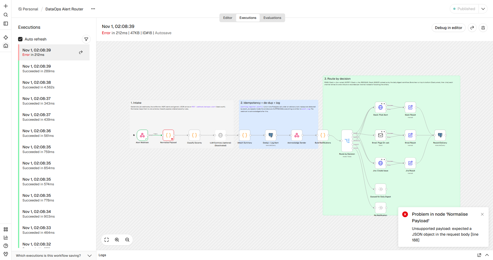
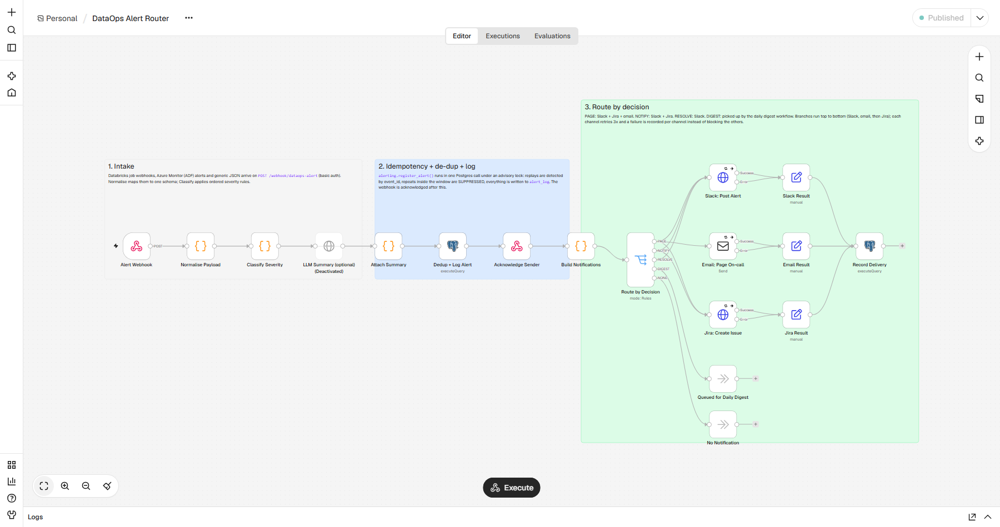
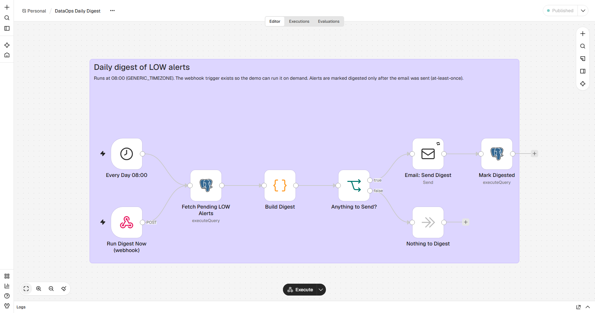
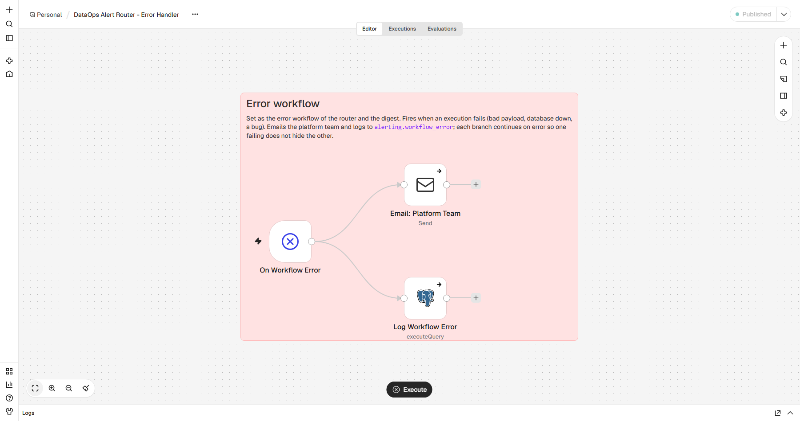

# Demo run: captured output

Everything on this page was copied from one local run of the stack on 1 November 2026 IST (Windows 10,
Docker Desktop, n8n 2.45.7, Postgres 17.11, Mailpit 1.32.0). The events are simulated: they come from
`simulator/`, not from a real Databricks workspace or Azure subscription, and "Slack" and "Jira" are
the local mock receiver. Nothing here was edited, except that the `n8n-import` log is filtered to
its import lines.

Commands that produced it:

```bash
cp .env.example .env            # then filled in local values
docker compose down -v && docker compose up -d --build
python -m simulator.simulate --reset --run-digest
python scripts/demo_report.py   # section 4 below
python scripts/screenshot_canvas.py
```

Timestamps in the logs are UTC; the n8n UI in the screenshots shows Asia/Kolkata time (UTC+5:30).

## 1. Startup: CLI import, no UI login needed

`n8n-import` is a one-shot container that runs before n8n starts. Its log (`docker compose logs n8n-import`,
filtered to the import lines):

```text
[import] rendering credentials from environment
Successfully imported 5 credentials.
[import] importing workflows from /opt/dataops/workflows
Successfully imported 3 workflows.
[import] publishing workflow dataopsAlertRtr1
Publishing workflow with ID: dataopsAlertRtr1 (current version)
[import] publishing workflow dataopsDigest001
Publishing workflow with ID: dataopsDigest001 (current version)
[import] publishing workflow dataopsErrorWf01
Publishing workflow with ID: dataopsErrorWf01 (current version)
[import] done
```

```text
SERVICE         IMAGE                                    STATUS
mailpit         axllent/mailpit:v1.32.0                  Up 6 minutes (healthy)
mock-receiver   n8n-dataops-alerts/mock-receiver:local   Up 6 minutes (healthy)
n8n             n8nio/n8n:2.45.7                         Up 3 minutes (healthy)
postgres        postgres:17.11-alpine                    Up 6 minutes (healthy)
```

The owner account was pre-created from `N8N_INSTANCE_OWNER_*` env vars only so that the editor
screenshots below could be taken. The webhooks and the simulator do not need it.

## 2. Simulator output

Each step states the decision it expects, and the simulator compares that with the webhook's
answer. The five burst events were sent at the same moment from five threads.

```text
reset: mock receiver, Mailpit and alert tables cleared
scenario           result what was sent                                                            response
----------------------------------------------------------------------------------------------------------------------------------------------------------------
databricks_failure PASS  Databricks job nightly_sales_etl failed (prod, tier 1)                   PAGE sev=CRITICAL rule=R3_tier1_failure id=1
adf_failure        PASS  ADF pl_ingest_crm_accounts PipelineFailedRuns fired (prod, tier 2)       NOTIFY sev=HIGH rule=R5_prod_failure id=2
adf_failure        PASS  Azure Monitor retries the same webhook delivery                          NOTIFY replay sev=HIGH rule=R5_prod_failure id=2
sla_breach         PASS  Databricks nightly_sales_etl exceeded its duration threshold (tier 1)    NOTIFY sev=HIGH rule=R6_sla_breach_tier1_2 id=3
sla_breach         PASS  Freshness check: gold.sales_daily not refreshed by 06:00 (tier 1)        NOTIFY sev=HIGH rule=R6_sla_breach_tier1_2 id=4
sla_breach         PASS  ADF pl_refresh_marketing_lookup elapsed-time breach (tier 3)             DIGEST sev=LOW rule=R7_default_low id=5
non_prod_failure   PASS  Databricks nightly_sales_etl failed in the dev workspace                 DIGEST sev=LOW rule=R2_non_prod id=6
duplicate_burst    PASS  5 failures of customer_360_refresh arrive at once (tier 2)               NOTIFY sev=HIGH rule=R5_prod_failure id=7; SUPPRESS sev=HIGH rule=R5_prod_failure id=10; SUPPRESS sev=HIGH rule=R5_prod_failure id=11; SUPPRESS sev=HIGH rule=R5_prod_failure id=8; SUPPRESS sev=HIGH rule=R5_prod_failure id=9
recovery           PASS  ADF pl_load_finance_gl failed (prod, tier 1)                             PAGE sev=CRITICAL rule=R3_tier1_failure id=12
recovery           PASS  ADF pl_load_finance_gl alert resolved                                    RESOLVE sev=INFO rule=R1_recovery id=13
recovery           PASS  Dev nightly_sales_etl succeeded (nothing paged, so log only)             LOG_ONLY sev=INFO rule=R1_recovery id=14
jira_outage        PASS  Jira is down (mock returns 503 x3) while a Sev1 ADF alert fires          PAGE sev=CRITICAL rule=R4_upstream_sev0_sev1 id=15
unknown_payload    PASS  Unrecognised JSON from some other tool                                   DIGEST sev=LOW rule=R7_default_low id=16
malformed_payload  PASS  Body is a JSON array, not an object (fails the execution)                HTTP 500 {'message': 'Error in workflow'}

digest: HTTP 200 {"marked_digested": 3}

all expectations met
```

What to notice:

- **Replay:** the second ADF delivery has the same `alertId`, so it returns the original row (`id=2`)
  with `replay` set, and nothing is sent again.
- **Burst:** five different Databricks runs of the same job, sent concurrently, gave exactly one
  `NOTIFY` and four `SUPPRESS` (occurrences 2 to 5). The Postgres advisory lock in
  `alerting.register_alert()` is what makes this hold under concurrency.
- **Recovery:** the ADF "Resolved" notification closes the open CRITICAL alert (`RESOLVE`, Slack only).
  The dev job's success had nothing paged to resolve, so it is `LOG_ONLY`.
- **Jira outage:** the webhook still answers `PAGE` at once (the sender is acknowledged after the
  alert is logged, before fan-out). Delivery results are in the delivery log below.
- **Malformed payload:** a JSON array fails `Normalise Payload`; n8n answers HTTP 500 (a sender that
  retries on 5xx would try again) and the error workflow fires.

## 3. n8n executions

Execution counts from n8n's own database (`execution_entity` joined to `workflow_entity`):

```text
               workflow               | status  | count 
--------------------------------------+---------+-------
 DataOps Alert Router                 | error   |     1
 DataOps Alert Router                 | success |    17
 DataOps Alert Router - Error Handler | success |     1
 DataOps Daily Digest                 | success |     1
(4 rows)
```



The failed execution is the malformed payload. The 4.5 s execution in the list is the Jira-outage
alert: three Jira attempts with a 2 s wait between them.

## 4. Evidence from the receivers and the alert log

### Mock receiver: what n8n sent to "Slack" and "Jira"

| target | outcome | count |
|---|---|---|
| jira | created | 6 |
| jira | forced_failure | 3 |
| slack | accepted | 8 |

Container log (`docker compose logs mock-receiver`):

```text
2026-10-31T20:38:29.564+00:00 SLACK 200 accepted: :rotating_light: CRITICAL: nightly_sales_etl failed (prod)
2026-10-31T20:38:29.996+00:00 JIRA  201 created: DATA-1 [CRITICAL] nightly_sales_etl failed (prod)
2026-10-31T20:38:30.671+00:00 SLACK 200 accepted: :warning: HIGH: pl_ingest_crm_accounts failed (prod)
2026-10-31T20:38:30.742+00:00 JIRA  201 created: DATA-2 [HIGH] pl_ingest_crm_accounts failed (prod)
2026-10-31T20:38:31.916+00:00 SLACK 200 accepted: :warning: HIGH: nightly_sales_etl breached SLA (prod)
2026-10-31T20:38:31.968+00:00 JIRA  201 created: DATA-3 [HIGH] nightly_sales_etl breached SLA (prod)
2026-10-31T20:38:32.601+00:00 SLACK 200 accepted: :warning: HIGH: gold.sales_daily breached SLA (prod)
2026-10-31T20:38:32.657+00:00 JIRA  201 created: DATA-4 [HIGH] gold.sales_daily breached SLA (prod)
2026-10-31T20:38:35.213+00:00 SLACK 200 accepted: :warning: HIGH: customer_360_refresh failed (prod)
2026-10-31T20:38:35.376+00:00 JIRA  201 created: DATA-5 [HIGH] customer_360_refresh failed (prod)
2026-10-31T20:38:36.692+00:00 SLACK 200 accepted: :rotating_light: CRITICAL: pl_load_finance_gl failed (prod)
2026-10-31T20:38:36.833+00:00 JIRA  201 created: DATA-6 [CRITICAL] pl_load_finance_gl failed (prod)
2026-10-31T20:38:37.427+00:00 SLACK 200 accepted: :white_check_mark: RESOLVED: pl_load_finance_gl (prod)
2026-10-31T20:38:38.782+00:00 SLACK 200 accepted: :rotating_light: CRITICAL: pl_refresh_marketing_lookup failed (prod)
2026-10-31T20:38:38.957+00:00 JIRA  503 forced_failure: - [CRITICAL] pl_refresh_marketing_lookup failed (prod)
2026-10-31T20:38:40.998+00:00 JIRA  503 forced_failure: - [CRITICAL] pl_refresh_marketing_lookup failed (prod)
2026-10-31T20:38:43.024+00:00 JIRA  503 forced_failure: - [CRITICAL] pl_refresh_marketing_lookup failed (prod)
```

First Slack message as received (Block Kit JSON):

```json
{
  "text": ":rotating_light: CRITICAL: nightly_sales_etl failed (prod)",
  "blocks": [
    {
      "type": "header",
      "text": {
        "type": "plain_text",
        "text": "CRITICAL: nightly_sales_etl failed (prod)"
      }
    },
    {
      "type": "section",
      "fields": [
        {
          "type": "mrkdwn",
          "text": "*Source*\nDatabricks job"
        },
        {
          "type": "mrkdwn",
          "text": "*Environment*\nprod"
        },
        {
          "type": "mrkdwn",
          "text": "*Run*\n<https://adb-1234567890123456.7.azuredatabricks.net/jobs/101/runs/479086812|479086812>"
        },
        {
          "type": "mrkdwn",
          "text": "*Alert id*\n1"
        }
      ]
    },
    {
      "type": "section",
      "text": {
        "type": "mrkdwn",
        "text": "*Summary:* [CRITICAL] Databricks job nightly_sales_etl failed in prod (run 479086812). Tier-1 pipeline failed in production.\n*Detail:* Job run failed\n*Rule:* R3_tier1_failure"
      }
    },
    {
      "type": "context",
      "elements": [
        {
          "type": "mrkdwn",
          "text": "fingerprint `databricks:prod:nightly_sales_etl:failure`"
        }
      ]
    }
  ]
}
```

First Jira create-issue request (answered with DATA-1):

```json
{
  "fields": {
    "summary": "[CRITICAL] nightly_sales_etl failed (prod)",
    "description": "[CRITICAL] Databricks job nightly_sales_etl failed in prod (run 479086812). Tier-1 pipeline failed in production.\n\n*Source:* Databricks job (jobs.on_failure)\n*Pipeline:* nightly_sales_etl\n*Environment:* prod\n*Run:* 479086812 https://adb-1234567890123456.7.azuredatabricks.net/jobs/101/runs/479086812\n*Detail:* Job run failed\n*Severity rule:* R3_tier1_failure - Tier-1 pipeline failed in production\n*Fingerprint:* databricks:prod:nightly_sales_etl:failure\n*Alert id:* 1",
    "priority": {
      "name": "Highest"
    },
    "labels": [
      "dataops-alert",
      "severity-critical",
      "source-databricks"
    ],
    "project": {
      "key": "DATA"
    },
    "issuetype": {
      "name": "Bug"
    }
  }
}
```

### Mailpit: emails caught

| to | subject |
|---|---|
| oncall-data@example.com | [CRITICAL] nightly_sales_etl failed in prod |
| oncall-data@example.com | [CRITICAL] pl_load_finance_gl failed in prod |
| oncall-data@example.com | [CRITICAL] pl_refresh_marketing_lookup failed in prod |
| data-platform@example.com | [n8n] DataOps Alert Router execution 18 failed at 'Normalise Payload' |
| data-team@example.com | DataOps daily digest: 3 low-severity alerts across 3 pipelines |

Plain-text body of the first email to oncall-data@example.com:

```text
Subject: [CRITICAL] nightly_sales_etl failed in prod

[CRITICAL] Databricks job nightly_sales_etl failed in prod (run 479086812). Tier-1 pipeline failed in production.


Severity: CRITICAL (rule R3_tier1_failure)

Why: Tier-1 pipeline failed in production

Source: Databricks job - jobs.on_failure

Pipeline: nightly_sales_etl

Environment: prod

Run: 479086812 https://adb-1234567890123456.7.azuredatabricks.net/jobs/101/runs/479086812

Detail: Job run failed

Fingerprint: databricks:prod:nightly_sales_etl:failure

Alert id: 1
```

Plain-text body of the first email to data-platform@example.com:

```text
Subject: [n8n] DataOps Alert Router execution 18 failed at 'Normalise Payload'

The alerting pipeline itself failed, so an alert may not have been routed.


Workflow: DataOps Alert Router (dataopsAlertRtr1)

Execution: 18 http://localhost:5678/workflow/dataopsAlertRtr1/executions/18

Failed node: Normalise Payload

Error: Unsupported payload: expected a JSON object in the request body [line 188]
```

Plain-text body of the first email to data-team@example.com:

```text
Subject: DataOps daily digest: 3 low-severity alerts across 3 pipelines

DataOps daily digest: 3 low-severity alerts across 3 pipelines


- unknown [unknown] info x1: [LOW] Unrecognised sender unknown reported an event in unknown. Low-impact or informational event.

- nightly_sales_etl [dev] failure x1: [LOW] Databricks job nightly_sales_etl failed in dev (run 479086814). Non-production environment.

- pl_refresh_marketing_lookup [prod] sla_breach x1: [LOW] ADF pipeline pl_refresh_marketing_lookup breached its SLA in prod (run 392a5047-97d7-417a-826a-83ce86c6f893). Low-impact or informational event.
```

### Alert log (`alerting.alert_overview`)

```text
 id |    source     |          pipeline           |   env   | event_type |  status  | severity | decision | occ |                                          deliveries                                           
----+---------------+-----------------------------+---------+------------+----------+----------+----------+-----+-----------------------------------------------------------------------------------------------
  1 | databricks    | nightly_sales_etl           | prod    | failure    | FIRING   | CRITICAL | PAGE     |   1 | slack:SENT, email:SENT(<a79a6990-3744-578b-2fd3-ea032e063eea@example.com>), jira:SENT(DATA-1)
  2 | azure_monitor | pl_ingest_crm_accounts      | prod    | failure    | FIRING   | HIGH     | NOTIFY   |   1 | slack:SENT, jira:SENT(DATA-2)
  3 | databricks    | nightly_sales_etl           | prod    | sla_breach | FIRING   | HIGH     | NOTIFY   |   1 | slack:SENT, jira:SENT(DATA-3)
  4 | sla_monitor   | gold.sales_daily            | prod    | sla_breach | FIRING   | HIGH     | NOTIFY   |   1 | slack:SENT, jira:SENT(DATA-4)
  5 | azure_monitor | pl_refresh_marketing_lookup | prod    | sla_breach | FIRING   | LOW      | DIGEST   |   1 | 
  6 | databricks    | nightly_sales_etl           | dev     | failure    | FIRING   | LOW      | DIGEST   |   1 | 
  7 | databricks    | customer_360_refresh        | prod    | failure    | FIRING   | HIGH     | NOTIFY   |   1 | slack:SENT, jira:SENT(DATA-5)
  8 | databricks    | customer_360_refresh        | prod    | failure    | FIRING   | HIGH     | SUPPRESS |   2 | 
  9 | databricks    | customer_360_refresh        | prod    | failure    | FIRING   | HIGH     | SUPPRESS |   3 | 
 10 | databricks    | customer_360_refresh        | prod    | failure    | FIRING   | HIGH     | SUPPRESS |   4 | 
 11 | databricks    | customer_360_refresh        | prod    | failure    | FIRING   | HIGH     | SUPPRESS |   5 | 
 12 | azure_monitor | pl_load_finance_gl          | prod    | failure    | FIRING   | CRITICAL | PAGE     |   1 | slack:SENT, email:SENT(<9175640d-756f-fbb1-1275-fcd2be960b56@example.com>), jira:SENT(DATA-6)
 13 | azure_monitor | pl_load_finance_gl          | prod    | failure    | RESOLVED | INFO     | RESOLVE  |   1 | slack:SENT
 14 | databricks    | nightly_sales_etl           | dev     | failure    | RESOLVED | INFO     | LOG_ONLY |   1 | 
 15 | azure_monitor | pl_refresh_marketing_lookup | prod    | failure    | FIRING   | CRITICAL | PAGE     |   1 | slack:SENT, email:SENT(<336d2f2a-be96-7300-daee-58bf7d2edd27@example.com>), jira:FAILED
 16 | unknown       | unknown                     | unknown | info       | FIRING   | LOW      | DIGEST   |   1 | 
(16 rows)
```

### Decisions

```text
 decision | severity | count 
----------+----------+-------
 DIGEST   | LOW      |     3
 LOG_ONLY | INFO     |     1
 NOTIFY   | HIGH     |     4
 PAGE     | CRITICAL |     3
 RESOLVE  | INFO     |     1
 SUPPRESS | HIGH     |     4
(6 rows)
```

### Delivery log (`alerting.delivery_log`)

```text
 id | alert_id | channel | status |                    external_ref                    |                                 detail                                 
----+----------+---------+--------+----------------------------------------------------+------------------------------------------------------------------------
  1 |        1 | slack   | SENT   |                                                    | Slack webhook returned 2xx
  2 |        1 | email   | SENT   | <a79a6990-3744-578b-2fd3-ea032e063eea@example.com> | SMTP accepted the message
  3 |        1 | jira    | SENT   | DATA-1                                             | Jira issue created
  4 |        2 | slack   | SENT   |                                                    | Slack webhook returned 2xx
  5 |        2 | jira    | SENT   | DATA-2                                             | Jira issue created
  6 |        3 | slack   | SENT   |                                                    | Slack webhook returned 2xx
  7 |        3 | jira    | SENT   | DATA-3                                             | Jira issue created
  8 |        4 | slack   | SENT   |                                                    | Slack webhook returned 2xx
  9 |        4 | jira    | SENT   | DATA-4                                             | Jira issue created
 10 |        7 | slack   | SENT   |                                                    | Slack webhook returned 2xx
 11 |        7 | jira    | SENT   | DATA-5                                             | Jira issue created
 12 |       12 | slack   | SENT   |                                                    | Slack webhook returned 2xx
 13 |       12 | email   | SENT   | <9175640d-756f-fbb1-1275-fcd2be960b56@example.com> | SMTP accepted the message
 14 |       12 | jira    | SENT   | DATA-6                                             | Jira issue created
 15 |       13 | slack   | SENT   |                                                    | Slack webhook returned 2xx
 16 |       15 | slack   | SENT   |                                                    | Slack webhook returned 2xx
 17 |       15 | email   | SENT   | <336d2f2a-be96-7300-daee-58bf7d2edd27@example.com> | SMTP accepted the message
 18 |       15 | jira    | FAILED |                                                    | 503 - "{\"errorMessages\":[\"Service unavailable (mock)\"],\"errors\":
(18 rows)
```

### Workflow errors (`alerting.workflow_error`)

```text
 error_id |    workflow_name     | execution_id |    failed_node    |                               error_message                                
----------+----------------------+--------------+-------------------+----------------------------------------------------------------------------
        1 | DataOps Alert Router | 18           | Normalise Payload | Unsupported payload: expected a JSON object in the request body [line 188]
(1 row)
```

### Digest bookkeeping

```text
 alert_id |          pipeline           | severity | decision | digested 
----------+-----------------------------+----------+----------+----------
        5 | pl_refresh_marketing_lookup | LOW      | DIGEST   | t
        6 | nightly_sales_etl           | LOW      | DIGEST   | t
       16 | unknown                     | LOW      | DIGEST   | t
(3 rows)
```

### Reading the results

- **Routing matrix:** the 3 PAGE alerts reached Slack, email and Jira; the 4 NOTIFY alerts reached
  Slack and Jira only; the RESOLVE reached Slack only; the 3 DIGEST alerts reached nobody until the
  digest ran, then went out together in one email. The 8 Slack messages, 6 created Jira issues
  and 3 on-call emails match that.
- **Channel isolation:** for alert 15 the mock Jira returned 503 three times. n8n retried (attempts
  2 s apart in the mock log), then recorded `jira: FAILED` while Slack and email were `SENT`. The
  email went out before the first Jira attempt because the branches run top to bottom (Slack, email,
  Jira): Mailpit's API reported the on-call email as received at 20:38:38.902 UTC, and the first
  Jira request reached the mock at 20:38:38.957.
- **Error workflow:** execution 18 (the array body) failed in `Normalise Payload`; the error workflow
  emailed `data-platform@example.com` and wrote a row to `alerting.workflow_error`.
- **Digest:** the three LOW alerts were grouped into one email and then marked `digested`.

## 5. Tests

`pytest` against the same Postgres (the SQL tests create and drop their own throwaway database):

```text
134 passed, 1 warning in 24.01s
```

## 6. Canvas screenshots

Taken with Playwright (`scripts/screenshot_canvas.py`) from the running instance.






